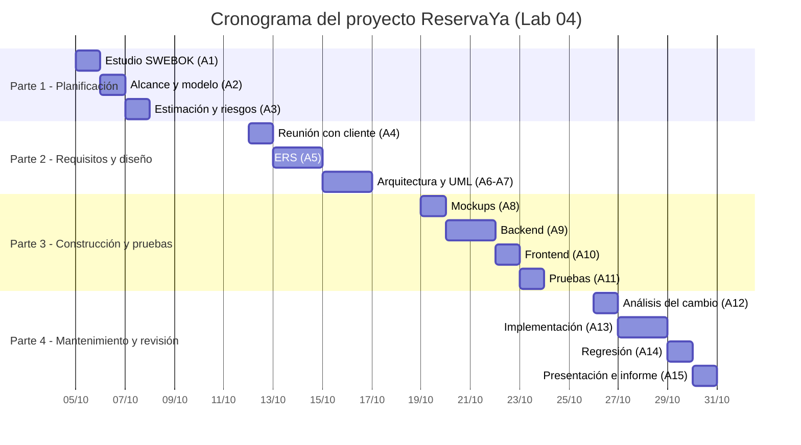

# Fase 1 — Introducción al proyecto y planificación del proceso de desarrollo

**Proyecto:** ReservaYa — Sistema de reservas en línea para una cadena de restaurantes
**Curso:** Gestión de Sistemas y Tecnologías de Información (UNSA)
**Versión del documento:** 1.0

---

## 1.1 Introducción a SWEBOK

El **SWEBOK** (*Software Engineering Body of Knowledge*), publicado por la IEEE Computer Society, reúne el conocimiento generalmente aceptado de la ingeniería de software y lo organiza en **áreas de conocimiento (KA)**. No es una metodología: es un mapa de referencia que indica *qué* debe saber y hacer un ingeniero de software, sin imponer *cómo* hacerlo. La versión 3.0 (2014) define 15 áreas; para este laboratorio se utilizan las siete que estructuran el ciclo de vida:

| # | Área de conocimiento (SWEBOK) | Qué cubre | Dónde se aplica en el proyecto |
|---|---|---|---|
| 1 | Proceso de software | Definición, implementación y mejora del ciclo de vida | Modelo iterativo-incremental (esta fase) |
| 2 | Requisitos de software | Elicitación, análisis, especificación y validación | Fase 2: acta con el cliente y ERS |
| 3 | Diseño de software | Arquitectura y diseño detallado de componentes | Fase 2: arquitectura en capas, UML |
| 4 | Construcción de software | Codificación, pruebas unitarias, depuración | Fase 3: API FastAPI + frontend |
| 5 | Pruebas de software | Verificación y validación frente a los requisitos | Fase 3: plan de pruebas y pytest |
| 6 | Mantenimiento de software | Corrección, adaptación y mejora tras el despliegue | Fase 4: módulo de recompensas |
| 7 | Gestión de la ingeniería de software | Planificación, seguimiento y control del proyecto | Transversal: plan, cronograma, riesgos |

### Proceso de software y fases clave del ciclo de vida

Según SWEBOK, un proceso de software es el conjunto de actividades, métodos y productos de trabajo que transforman necesidades en software. Las fases clave que se siguen en este proyecto son:

1. **Planificación** — alcance, modelo de proceso, estimaciones, riesgos.
2. **Requisitos** — elicitación con el cliente y especificación.
3. **Diseño** — arquitectura y diseño detallado (UML).
4. **Construcción** — implementación y pruebas unitarias.
5. **Pruebas** — verificación funcional y de API, criterios de aceptación.
6. **Mantenimiento** — incorporación de cambios y pruebas de regresión.

## 1.2 Presentación del proyecto

Una cadena de restaurantes con varias sucursales necesita que sus clientes puedan:

- **Reservar mesas** en una sucursal, fecha, hora y para un número de personas.
- **Cancelar o modificar** sus reservas.
- **Recibir notificaciones de confirmación** (creación, modificación y cancelación).

**Alcance técnico acordado:** API REST con Python + FastAPI, base de datos SQLite (SQLAlchemy), frontend HTML/CSS/JavaScript sin frameworks y pruebas con pytest. Las notificaciones se **simulan**: se registran en la base de datos y en un archivo de log (el envío real por correo/SMS queda fuera del alcance).

## 1.3 Plan de desarrollo de software

### Modelo de proceso elegido: iterativo-incremental

Se elige un **modelo iterativo-incremental** (con prácticas ágiles ligeras) en lugar de un modelo en cascada, por estas razones:

- **Requisitos cambiantes:** la guía anticipa un cambio de requisitos en la Parte 4 (recompensas). Un modelo en cascada, tal como lo describe Royce (1970), hace costoso volver a fases anteriores; el iterativo absorbe el cambio como un nuevo incremento.
- **Entregas funcionales tempranas:** cada iteración termina con un producto verificable (documentos, diagramas, código probado).
- **Retroalimentación del cliente:** al final de cada incremento se valida con el cliente (docente/compañero).
- **Coherencia con SWEBOK:** el área de *Proceso de software* reconoce los modelos iterativos/incrementales como adecuados cuando el riesgo de cambio es alto (ver pregunta 6 del cuestionario).

Iteraciones planificadas:

| Iteración | Incremento entregado |
|---|---|
| I-1 | Plan del proyecto (esta fase) |
| I-2 | ERS + diseño (arquitectura, UML) |
| I-3 | Núcleo funcional: reservas + notificaciones + frontend + pruebas |
| I-4 | Cambio de requisitos: recompensas + regresión + presentación |

### Fases del ciclo de vida y entregables

| Fase (SWEBOK) | Actividades | Entregables |
|---|---|---|
| 1. Planificación (Proceso / Gestión) | Estudio de SWEBOK, definición de alcance, modelo de proceso, estimación, riesgos | `docs/fase1_planificacion.md` (plan, cronograma, riesgos) |
| 2. Requisitos | Reunión con el cliente, análisis, especificación IEEE 830/29148, validación | Acta de reunión, ERS (RF, RNF, restricciones, casos de uso, criterios de aceptación) |
| 3. Diseño | Arquitectura en capas, modelo de datos, diseño detallado | Diagrama de arquitectura, diagrama de clases, diagrama de secuencia (fuente `.puml` + `.png`) |
| 4. Construcción | Mockups, implementación de la API y del frontend | `mockups/`, `backend/app/`, `frontend/` |
| 5. Pruebas | Plan de pruebas, pruebas unitarias y de API | Plan de pruebas, `backend/tests/`, `docs/evidencias/pytest_fase3.txt` |
| 6. Mantenimiento | Cambio de requisitos (recompensas), actualización de ERS/UML, regresión | `docs/fase4_mantenimiento.md`, `docs/evidencias/pytest_fase4.txt` |
| 7. Revisión | Presentación final del proyecto | `docs/presentacion_final.md`, informe DOCX |

### Estimación de tiempo por actividad

La guía asigna en promedio **3 horas por parte** (12 h de laboratorio). La estimación se hizo por juicio experto y descomposición de tareas (WBS); se añade trabajo autónomo fuera del laboratorio.

| ID | Actividad | Fase | Horas estimadas |
|---|---|---|---|
| A1 | Estudio de SWEBOK y sus áreas | Planificación | 1.0 |
| A2 | Definición de alcance y modelo de proceso | Planificación | 0.5 |
| A3 | Estimación, cronograma y riesgos | Planificación | 1.5 |
| A4 | Reunión con el cliente y acta | Requisitos | 1.0 |
| A5 | Redacción de la ERS (RF, RNF, restricciones, casos de uso) | Requisitos | 2.0 |
| A6 | Arquitectura y modelo de datos | Diseño | 1.0 |
| A7 | Diagramas UML de clases y de secuencia | Diseño | 1.0 |
| A8 | Mockups de interfaces | Construcción | 1.0 |
| A9 | Implementación de modelos, servicios y API | Construcción | 3.0 |
| A10 | Implementación del frontend | Construcción | 2.0 |
| A11 | Plan de pruebas y pruebas unitarias/API | Pruebas | 2.0 |
| A12 | Análisis del cambio (recompensas) y actualización de ERS/UML | Mantenimiento | 1.0 |
| A13 | Implementación del cambio | Mantenimiento | 1.5 |
| A14 | Pruebas de regresión | Mantenimiento | 0.5 |
| A15 | Preparación de la presentación e informe | Revisión | 2.0 |
| | **Total** | | **21.0** |

### Cronograma

Exportado como imagen en `docs/diagramas/cronograma_gantt.png` (fuente `cronograma_gantt.puml`).

### Riesgos principales

| ID | Riesgo | Probabilidad | Impacto | Mitigación |
|---|---|---|---|---|
| R1 | Cambios de requisitos durante el desarrollo | Alta | Medio | Modelo iterativo; requisitos versionados; diseño en capas desacoplado |
| R2 | Doble reserva de una mesa (solapamiento) | Media | Alto | Validación de disponibilidad en la capa de servicios + pruebas unitarias específicas |
| R3 | Subestimación del tiempo de construcción | Media | Medio | Priorizar RF esenciales (MoSCoW); dejar mejoras visuales para el final |
| R4 | Falta de disponibilidad del "cliente" para validar | Media | Medio | Acta de reunión con acuerdos firmados; validación asíncrona |
| R5 | Fallos en el envío real de notificaciones | Baja | Bajo | Notificaciones simuladas (BD + log) con interfaz desacoplada para un futuro SMTP |
| R6 | Pérdida de código o versiones | Baja | Alto | Repositorio Git (commit al cierre) y copias locales |

---

